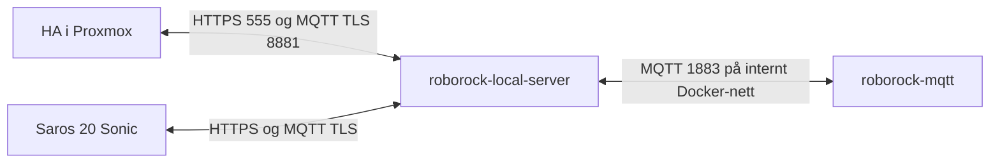

# Roborock med egen MQTT-broker i Docker-stacken

Home Assistant OS kjører i Proxmox-VM-en. På Docker-serveren, i samme
støttestack som for eksempel Music Assistant, kjører to egne tjenester:

- `roborock-local-server`: standard upstream-server v1.2.1, HTTPS og MQTT/TLS.
- `roborock-mqtt`: dedikert Mosquitto 2.1.2 i egen container med eget datavolum.



Bare lokalserveren publiserer porter på Docker-serverens LAN-IP. Mosquitto har
ingen publisert verts-/LAN-port og er bare tilkoblet det interne nettverket
`roborock_mqtt`. Den bruker ikke HA sin vanlige MQTT-broker. Roborock-serveren
har også et vanlig Docker-nettverk for HTTPS/TLS, kontoimport og sertifikatfornyelse.

Dette bruker upstreams støttede **eksterne broker-modus**. Serverimaget inneholder
fortsatt Mosquitto-binæren, men starter ikke den innebygde brokerprosessen i denne
modusen. Ingen fork eller endring av HA-integrasjonen er nødvendig.

## 1. Klargjør standardserveren

På Docker-serveren: velg en varig katalog og installer `uv` etter upstreams
veiledning. HA Core 2026.11.1 støtter manuell serveradresse; eierens Saros 20
Sonic har oppgitt firmware 02.58.82.

```bash
git clone --branch v1.2.1 --depth 1 https://github.com/Python-roborock/local_roborock_server.git /srv/roborock-local-server
cd /srv/roborock-local-server
uv sync
uv run roborock-local-server configure
mkdir -p data secrets mqtt
docker build -t local/roborock-local-server:1.2.1 .
curl -fsSL https://raw.githubusercontent.com/mvheimburg/roborock-companion/main/deploy/roborock/mosquitto.conf -o mqtt/mosquitto.conf
```

Bruk et kort `api-...`-navn, EU-region, porter `555`/`8881`, lokale admin-/
protokollpassord og riktig sertifikatvalg. Byggingen henter vanlige basisbilder
og avhengigheter. Brokerimaget er versjonslåst til den offisielle taggen
`eclipse-mosquitto:2.1.2-alpine`.

## 2. Sett ekstern broker i config.toml

Rediger den **eksisterende** `[broker]`-seksjonen i konfigurasjonen fra veiviseren:

```toml
[broker]
mode = "external"
host = "roborock-mqtt"
port = 1883
enable_topic_bridge = true
```

Behold øvrige server-, TLS-, innloggings- og lagringsfelt. Dette er TOML-felter,
ikke Compose-miljøvariabler. Serveren bruker Docker-tjenestens navn som DNS-navn.
Robot og HA bruker fortsatt `ssl://DITT_API_NAVN:8881`, aldri `roborock-mqtt:1883`.

Den medfølgende `mosquitto.conf` tillater anonyme backend-klienter fordi serverens
topic bridge bruker en slik forbindelse. Dette er avgrenset til det egne interne
Docker-nettverket; TLS/protokollinnlogging håndteres av Roborock-serveren foran
brokeren. La brokeren være uten `ports:`, og knytt bare disse to tjenestene til
`roborock_mqtt`. Ikke bruk denne konfigurasjonen på en LAN-eksponert fellesbroker.

## 3. Legg begge tjenestene i stacken

Ta backup av stackfilen og `config.toml`. Fra `compose.fragment.yaml`, flett inn:

- begge tjenestene under eksisterende `services:`;
- `roborock_mqtt` under eksisterende `networks:`;
- `roborock_mqtt_data` under eksisterende `volumes:`.

Opprett seksjonene hvis de mangler; ha én toppnivånøkkel av hver type. Behold
stackens eksisterende `default`-nettverk hvis det allerede er definert. Brokerens
navngitte datavolum får Compose-prosjektets/stackens prefiks automatisk.

Sett følgende i stackens `.env`, eller som stack-miljøvariabler i Portainer:

```dotenv
ROBOROCK_BIND_ADDRESS=192.168.10.20
ROBOROCK_SERVER_ROOT=/srv/roborock-local-server
```

IP-adressen er et eksempel: bruk Docker-serverens faktiske LAN-IP, ikke HA-VM-ens
IP. `ROBOROCK_SERVER_ROOT` må være en absolutt katalog på Docker-serveren.
`config.toml`, `data/`, `secrets/` og `mqtt/mosquitto.conf` må finnes; manglende
bind-filer skal gi en feil fremfor å bli opprettet som kataloger.

## 4. Start broker og server

```bash
docker compose config --quiet
docker compose up -d --force-recreate roborock-local-server
docker compose ps roborock-mqtt roborock-local-server
docker compose logs --tail 100 roborock-mqtt roborock-local-server
```

Compose starter `roborock-mqtt` som avhengighet og venter på dens MQTT-healthcheck
før serveren starter. Healthchecken sender en tom QoS 1-melding på et eget
helsetopic, uten retained-flagg. Andre tjenester i stacken behøver ikke restartes.
Ved senere endringer i den bind-monterte `config.toml` må serveren restartes eller
opprettes på nytt for å lese inn filen. I Portainer brukes tilsvarende oppdatering/
gjenoppretting av Roborock-tjenesten.

Hvis du allerede kjører med innebygd broker, stopp `roborock-local-server` før du
bytter broker-modus. Behold serverens `data/` og `secrets/`; ikke slett eller
kopier den gamle brokerens database over den nye. Den nye brokeren starter med
tomme MQTT-sesjoner, så klientene må koble til på nytt. Kontroller kontakt, kart
og status etter omstart før du tar i bruk automatiseringer.

Portene `555` og `8881` må være ledige på valgt LAN-IP. Mosquitto-port `1883`
skal ikke publiseres. Ingen host-nettverk, privilegert container, Docker-socket
eller internettportviderekobling trengs. Fragmentet gjelder Compose/Portainer
standalone, ikke Docker Swarm.

## 5. DNS, HA og videre oppsett

Lokal DNS for `api-...` skal peke på **Docker-serveren**. Kontroller DNS og portene
fra både robotens VLAN og HA-VM-en. Åpne `https://DITT_NAVN:555/admin`.
Serverens healthcheck bruker `-k` kun internt; robot, HA og onboarding skal bruke
korrekt navn og et gyldig sertifikat.

Følg [hele oppskriften](../../docs/roborock-local-setup.nb.md) for kontoimport,
sammenkobling og HA-oppsett. Den offisielle Roborock-integrasjonen bruker
**Manual** med lokalserverens adresse. Ingen ekstra HA MQTT-integrasjon behøves
for denne Roborock-brokeren.

## 6. Backup og oppdatering

Ta med `config.toml`, `secrets/`, `data/`, `mqtt/mosquitto.conf` og det navngitte
Docker-volumet `roborock_mqtt_data` i stackens backup. Brokerdata tas konsistent
mens brokeren er stoppet, eller med et egnet konsistent volum-snapshot. Behandle
kopiene som private hjemmedata. Planlegg sertifikatfornyelse og velg oppdateringer
av både server- og brokerimage bevisst.

Robotens WAN sperres i ruteren. Begrens servercontainerens utgående trafikk etter
import med nødvendige unntak for sertifikatfornyelse; andre tjenester på
Docker-verten kan fortsatt trenge Internett. Eksemplet er kildekontrollert og
Compose-validert, men ikke deployert eller nettverksverifisert på eierens server.

Kilder: [ekstern broker i upstream v1.2.1](https://github.com/Python-roborock/local_roborock_server/blob/v1.2.1/src/roborock_local_server/server.py#L1900),
[broker-konfigurasjon](https://github.com/Python-roborock/local_roborock_server/blob/v1.2.1/src/roborock_local_server/config.py#L226),
[offisielle Mosquitto-imager](https://github.com/docker-library/official-images/blob/master/library/eclipse-mosquitto)
og [Mosquitto-konfigurasjon](https://mosquitto.org/man/mosquitto-conf-5.html).
