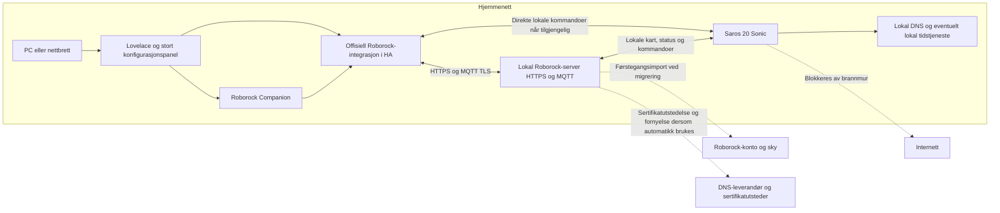

# Lokal Roborock med Home Assistant og stort konfigurasjonspanel

Målet er at Saros 20 Sonic styres og konfigureres i Home Assistant, med
`local_roborock_server` som lokal erstatning for Roborocks skytjeneste.
Den offisielle HA-integrasjonen beholdes. Vårt Lovelace-kort brukes til daglig;
Roborock Companion gir en større konfigurasjonsside for kart og romdetaljer som
standardintegrasjonen ikke eksponerer til dashboardet.

**Vi trenger normalt ikke endre kildekoden i HA-integrasjonen.** HA 2026.11.1
har manuell serveradresse i oppsettet. Dette er kontrollert i
[HA-koden](https://github.com/home-assistant/core/blob/2026.11.1/homeassistant/components/roborock/config_flow.py).
Hvis valget mangler i din installasjon, må HA-versjonen kontrolleres før migrering.
Companion/kortet er under utvikling; serveren og standardintegrasjonen kan settes
opp og prøves før disse installeres.

Oppskriften beskriver standardserverens stabile utgave 1.2.1 og dokumentasjonen
kontrollert 17. november 2026. Modellrapporten for Saros 20 Sonic a279 med
firmware 02.58.82 endte med fungerende lokalserver, men krevde nytt serveroppsett
og flere sammenkoblinger. Den bekrefter ikke at hver avansert funksjon virker på
andre firmwareversjoner. Noter din firmware før du begynner.
[Utgivelse](https://github.com/Python-roborock/local_roborock_server/releases/tag/v1.2.1),
[modellrapport](https://github.com/Python-roborock/local_roborock_server/issues/217#issuecomment-6504895070).

## Trafikken vi vil oppnå



De stiplede pilene viser forbindelser som krever en bevisst beslutning.
Kart skal gå til din lokale server. TLS-sertifikatets utsteder får ikke dermed
rengjøringskart; sertifikattjenesten håndterer domenebekreftelse og sertifikater.
Det er en annen trafikkstrøm enn Roborock-kontoen.

| Data eller funksjon | Ønsket plassering | Forutsetning eller gjenværende ekstern kontakt |
| --- | --- | --- |
| Kart, rom og robotens rapporterte aktivitet | Robot, lokalserver og HA | Roboten er sammenkoblet med lokalserveren; HA peker på samme server. |
| Start, stopp, romvalg, tilgjengelige mopp- og dokkekommandoer | Lokalt | HA bruker direkte robotforbindelse eller MQTT mot lokalserveren. Modellstøtte varierer. |
| Konfigurasjon fra vår PC/nettbrettside | Lokalt gjennom HA | Companion bruker HA sin eksisterende forbindelse. Full modellstøtte må verifiseres. |
| HA-automatiseringer og recorderhistorikk | HA | Krever ingen åpen nettleser. |
| Import av eksisterende konto, enheter, rom og rutiner | Lokal kopi etter import | Importen logger inn hos Roborock og henter data derfra. Dette er ikke en helt skyfri migrering. |
| Sertifikater med Cloudflare DNS-01 og ZeroSSL | Ekstern utstedelse, lokal bruk | Domenekontroll og fornyelse kontakter disse tjenestene. Ingen offentlig portåpning er nødvendig. |
| Nedlasting og oppdatering av server/HA/HACS | Eksterne programvarelagre | GitHub/GHCR og eventuelle HA-registre er ikke Roborocks driftssky. |
| Offisiell Roborock-app på mobilen | Ikke del av løsningen i daglig bruk | Kan fortsatt kontakte leverandør/apputgivere selv om robotens WAN er blokkert. Bruk HA eller LocalRock til den lokale serveren etter migrering. |
| Kamera og firmwareoppdateringer | Ikke inkludert i første oppsett | Egne modell-/firmwareavhengige begrensninger; aktiver ikke eksternt TURN eller OTA som en skjult reservevei. |
| Robotens direkte telemetri, offentlige DNS eller øvrig WAN | Blokkert | Må håndheves i ruteren, også for IPv6; et lokalt DNS-oppslag alene hindrer ikke dette. |

Dette er en målarkitektur og en anbefalt nettverkspolicy, ikke et resultat av
målinger på ditt nett. «Til Kina» kan vi ikke fastslå ut fra Roborock-navnet eller
regionvalget: mottakerland, viderebehandling og faktisk trafikk må vurderes hver
for seg. Vi kan derimot blokkere direkte WAN-trafikk og teste at tjenesten virker
uten den. Ingen påstand her gjelder andre enheter/tjenester i hjemmenettet.

## Valgt installasjon hos eieren

Home Assistant OS 18.4 kjører i Proxmox, med Core 2026.11.1 og Supervisor
2026.11.0. Saros 20 Sonic har firmware 02.58.82. Den lokale Roborock-serveren
skal ligge i eierens eksisterende Docker-stack for støttetjenester, sammen med
blant annet Music Assistant. Bruk derfor **3B**, ikke installer en ekstra
Roborock-server som HA-app. Servernavnet peker på Docker-vertens LAN-IP.
[Stack-eksempel](../deploy/roborock/README.nb.md).

## 1. Gjør klart nett og tilgang

Du trenger en HA-installasjon med appstøtte, eller en Linux-maskin/VM med Docker,
et domene du kontrollerer, lokal DNS og en PC med Wi-Fi til sammenkoblingen.
Sett av minst én CPU-kjerne og 1 GB RAM under sammenkoblingen.

Bruk følgende som eksempel og erstatt navn/adresse med dine egne:

| Verdi | Eksempel |
| --- | --- |
| Serverens lokale navn | `api-rr.example.com` |
| Serverens LAN-adresse | `192.168.10.20` |
| HTTPS-port | TCP `555` |
| MQTT med TLS | TCP `8881` |
| Tidssone | `Europe/Oslo` |
| Region ved norsk/EU-oppsett | `eu` |

`example.com` er et eksempel, ikke et domene du skal bruke. Servernavnet skal
begynne med `api-`. Hold navnet kort: robotens normaliserte `host[:port]/`-verdi
etter at `api-` er fjernet har en grense på 32 tegn.

Lag lokal DNS slik at servernavnet peker på LAN-adressen. Kontroller fra PC-en,
HA og robotens nett/VLAN at navnet løses til samme lokale server. En hosts-fil
på PC-en alene løser ikke robotens DNS. Gi server og robot faste DHCP-reservasjoner.

```bash
nslookup api-rr.example.com
```

Tillat lokal trafikk til serverens TCP 555 og 8881, og HA sin direkte
robotforbindelse der den brukes (TCP 58867 og UDP 58866). Sørg også for lokal
DNS, DHCP og nødvendig tidssynkronisering. Ikke videresend disse portene fra
Internett, og ikke legg servernavnet bak Cloudflare sin proxy.
[Installasjon og nett](https://github.com/Python-roborock/local_roborock_server/blob/main/docs/installation.md),
[HA-nettverk](https://www.home-assistant.io/integrations/roborock/#troubleshooting).

## 2. Velg sertifikat

For Saros 20 Sonic finnes en fungerende rapport med ZeroSSL. Start derfor med
ZeroSSL med mindre din eksakte firmware har en annen dokumentert forutsetning.
Dette krever et ordinært, betrodd sertifikat og riktig full kjede; ikke anta at
roboten godtar et selvsignert sertifikat bare fordi nettleseren gjør det.

En enkel automatisk vei er Cloudflare DNS-01 med ZeroSSL. Domenets DNS-sone må
da administreres hos Cloudflare. Lag et API-token med DNS-redigering bare for
aktuell sone. Dette krever ingen offentlig åpning inn til serveren. Alternativt
bruker du egne sertifikatfiler med `tls_mode: provided` og fornyer dem med et
verktøy du allerede har.
[Cloudflare-oppsett](https://github.com/Python-roborock/local_roborock_server/blob/main/docs/cloudflare_setup.md),
[egne sertifikater](https://github.com/Python-roborock/local_roborock_server/blob/main/docs/custom_cert_management.md).

## 3A. Installer som HA-app

Bruk dette på HA OS eller annen installasjon som faktisk har appbutikken.
HA Container har ikke appbutikken; bruk 3B der.

1. Åpne **Innstillinger → Apper** (tidligere Tillegg), appbutikken og
   **Repositories/Lagre**.
2. Legg til `https://github.com/Python-roborock/local_roborock_server`.
3. Installer **Roborock Local Server**, standardutgaven, ikke Beta.
4. Sett de følgende feltene. Behold øvrige standardverdier. Erstatt alle
   eksempelverdier; sett PIN/passord i appens oppsett og ikke i publiserte filer.

| Felt | Verdi |
| --- | --- |
| `stack_fqdn` | Ditt korte `api-...`-navn |
| `https_port` | `555` |
| `mqtt_tls_port` | `8881` |
| `advertised_https_port`, `advertised_mqtt_tls_port` | `0` ved direkte lokal tilgang |
| `region` | `eu` for dette norske/EU-oppsettet |
| `admin_password` | Et nytt, sterkt passord til lokalserverens administrasjon |
| `protocol_login_email` | E-postidentifikator for lokal innlogging, for eksempel din vanlige adresse |
| `protocol_login_pin` | En ny, tilfeldig sekssifret lokal PIN |
| `tls_mode` | `cloudflare_acme` ved automatisk sertifikat |
| `tls_base_domain` | Domenet sertifikatet skal dekke |
| `tls_email` | E-post til sertifikatutstedelse |
| `acme_server` | `zerossl` |
| `cloudflare_token` | Det begrensede DNS-tokenet |
| `turn_mode` | `disabled` i dette oppsettet |

Ved egne sertifikater velger du `provided` og angir `cert_file` og `key_file`
slik filene er tilgjengelige inne i appcontaineren, for eksempel i `/ssl`.

Start appen. Åpne `https://api-rr.example.com:555/admin` og kontroller at
sertifikatet er gyldig. Adressen skal bruke servernavnet sertifikatet dekker,
ikke vilkårlig IP eller HA sitt andre domenenavn.
[Appveiledning](https://github.com/Python-roborock/local_roborock_server/blob/main/docs/home_assistant.md),
[faktiske felt i appversjon 1.2.1](https://github.com/Python-roborock/local_roborock_server/blob/main/roborock_local_server_addon/config.yaml).

## 3B. Alternativ med Docker

På Linux-maskinen/VM-en, installer Docker Compose og `uv` etter leverandørenes
instruksjoner. Bruk standardserverens konfigurasjonsveiviser:

```bash
git clone --branch v1.2.1 --depth 1 https://github.com/Python-roborock/local_roborock_server.git
cd local_roborock_server
uv sync
uv run roborock-local-server configure
docker compose up -d --build
```

I veiviseren bruker du samme servernavn, porter, EU-region, sertifikatvalg,
adminpassord og lokale protokollinnlogging som i 3A. Bruk innebygd MQTT til
første oppsett; dette krever ingen endring i en eksisterende HA MQTT-installasjon.
Hvis egne sertifikater brukes, skal de ligge i den monterte katalogen og
konfigurasjonen peke til containerstiene, ikke verts-PC-ens private stier.
Åpne deretter `/admin` på servernavnet som i 3A.
[Docker-oppsett](https://github.com/Python-roborock/local_roborock_server/blob/main/docs/installation.md).

## 4. Importer eksisterende robot

1. Logg inn på `/admin` med lokalserverens adminpassord.
2. Åpne **Cloud import**.
3. Bruk Roborock-kontoens e-postadresse og region, be om kode, og velg **Fetch data**.
4. Kontroller at akkurat din Saros 20 Sonic vises i inventaret.
5. Ta backup av serverkonfigurasjon og vedvarende serverdata før videre migrering.

Dette er kontakten med Roborock vi planlegger under migrering av en allerede
registrert robot. Den lokale protokoll-PIN-en er en annen kode enn e-postkoden
fra Roborock. Ikke del eksporten offentlig; den kan inneholde hjemmedata og nøkler.
Importerte sonerutiner kan kreve at de lagres på nytt i den offisielle appen
før siste import. Se installasjonsveiledningen for akkurat den rutinetypen.

Nyere utviklingsdokumentasjon beskriver også en «New vacuum»-flyt uten tidligere
skyregistrering. Vi legger ikke til grunn at den er verifisert for din Sonic og
standardutgave 1.2.1; hovedoppskriften bruker den eksisterende robotimporten.
[Import](https://github.com/Python-roborock/local_roborock_server/blob/main/docs/installation.md),
[ny robot](https://github.com/Python-roborock/local_roborock_server/blob/main/docs/onboarding.md#onboarding-a-vacuum-that-was-never-on-the-cloud).

## 5. Koble roboten til lokalserveren

Blokker robotens direkte WAN i ruteren, men behold tilgang til lokalserver,
lokal DNS/DHCP og tid. Dekk både IPv4 og IPv6. På enkelte nye Saros-modeller er
forsøk mot offentlig DNS rapportert; å bare endre DHCP-DNS er derfor utilstrekkelig.
Dette er rapportert på andre Saros-varianter og er ikke en måling på din Sonic.
[Observerte nettverksproblemer](https://github.com/Python-roborock/local_roborock_server/blob/main/docs/onboarding.md#network-and-resource-checks).

På en annen PC med Wi-Fi, Python 3.11+ og `uv`:

```bash
git clone --branch v1.2.1 --depth 1 https://github.com/Python-roborock/local_roborock_server.git
cd local_roborock_server
uv run start_onboarding.py --server api-rr.example.com --timezone Europe/Oslo --country-domain eu --cst 'CET-1CEST,M3.5.0,M10.5.0/3'
```

La programmet spørre etter adminpassord, hjemmenettets SSID og Wi-Fi-passord.
Da slipper du å skrive passord i kommandolinjehistorikken. Bruk riktig Wi-Fi for
roboten; følg modellens krav til frekvensbånd.

Følg veiviseren: velg den importerte roboten, nullstill **Wi-Fi** etter Sonic-
manualens instruksjoner, koble PC-en til robotens midlertidige nett, send
oppsettet, og koble PC-en tilbake til hjemmenettet. Ikke foreta full fabrikkreset
som første steg. Programmet kan be om flere runder mens nøkkelutledning og
sammenkobling fullføres. Kontroller at roboten ender som tilkoblet i `/admin`.
[Onboarding](https://github.com/Python-roborock/local_roborock_server/blob/main/docs/onboarding.md).

LocalRock-mobilappen kan også brukes til sammenkoblingen, men er ikke nødvendig
for denne PC-baserte oppskriften. Installerer du appen, skal den peke på din lokale
server, ikke en fork av appen eller den opprinnelige Roborock-skyen.

## 6. Koble den offisielle HA-integrasjonen til lokalserveren

Appinstallasjonen endrer ikke HA-integrasjonen automatisk.

Ved ny HA-integrasjon:

1. Gå til **Innstillinger → Enheter og tjenester → Legg til integrasjon → Roborock**.
2. Velg **Manual/Manuell** som serverregion.
3. Oppgi `https://api-rr.example.com:555` som serveradresse, uten `/admin`.
4. Bruk lokalserverens `protocol_login_email`.
5. Skriv lokalserverens `protocol_login_pin` i feltet for verifikasjonskode.
6. Kontroller at enheter, entiteter og kart kommer fra riktig robot.

Det kommer ingen e-postkode fra den lokale serveren; feltet i HA heter fortsatt
verifikasjonskode. Den ordinære Roborock-integrasjonen brukes videre.
[Standardintegrasjon mot lokalserver](https://github.com/Python-roborock/local_roborock_server/blob/main/docs/home_assistant.md#connect-home-assistant-to-the-local-stack).

Hvis du allerede har Roborock i HA, velg én migreringsvei før du endrer noe:

- **Enkel nyregistrering:** ta full HA-backup, noter eksisterende entitets-ID-er og
  bindinger, fjern og legg til Roborock med Manual. Ikke anta at fjerning og
  nyregistrering bevarer ID-er, historikk eller dashboardbindinger.
- **Behold eksisterende registrering:** upstream beskriver en manuell
  `.storage/core.config_entries`-endring. Ta full backup og stopp HA Core helt
  før filen redigeres; ikke rediger den mens HA kjører. I den aktuelle Roborock-
  oppføringens `data` oppdateres `base_url`, `username` og endepunktene
  `user_data.rriot.r.a`, `.l` og `.m` til lokalserverens HTTPS/HTTPS/MQTT-adresser.
  For eksempel er MQTT-adressen `ssl://api-rr.example.com:8881`. Start HA og
  fullfør eventuell reautentisering med lokal PIN. Behold oppføringens ID og
  øvrige registerdata. Dette er en kontrollert administrasjonsoppgave, ikke
  vanlig konfigurering i kortet.

[Upstreams migreringsalternativer](https://github.com/Python-roborock/local_roborock_server/blob/main/docs/home_assistant.md#existing-roborock-integration-repointing-from-cloud).
Ikke kjør begge migreringsveiene eller slett en eksisterende oppføring først
hvis du vil bevare dens identitet.

## 7. Bekreft lokal drift med brannmur

Denne kontrollen skiller «konfigurert lokalt» fra faktisk verifisert drift:

1. Bekreft at robotens utgående Internett-trafikk er blokkert, inkludert IPv6.
2. Se i lokal DNS-logg og serverlogg at robot og HA bruker riktig lokalserver.
3. Prøv start/pause/hjem og de mopp-/dokkekontrollene din modell eksponerer.
4. Kontroller at kart faktisk oppdateres under en ny rengjøring, ikke bare viser
   et gammelt bufferbilde.
5. Start robot/lokalserver/HA på nytt og gjenta med WAN-blokkeringen beholdt.
6. Etter import: begrens lokalserverens utgående trafikk. Ved automatisk
   sertifikatfornyelse må den nødvendige CA/DNS-trafikken fortsatt fungere,
   eventuelt flyttes fornyelsen til en annen vert som leverer sertifikatfiler.
7. Kontroller særskilt HA sin utgående Roborock-trafikk; HA driver også andre
   tjenester, så det er ikke nok å blokkere roboten for å konkludere om hele kjeden.
8. Bruk ruterens blokkerings-/trafikklogger for både robot, server og HA. Ved behov
   kan pakkefangst bekrefte mottakeradresser og trafikkmengde; kryptert trafikk
   avslører ikke uten videre hvilket innhold som sendes eller viderebehandles.

Ikke blokker hele HA-maskinens Internett ukritisk hvis den også betjener andre
integrasjoner. Behold nødvendige lokale ruter på tvers av VLAN. En ekstern
DNS-/NTP-tjeneste er en egen ekstern forbindelse; bruk lokale tjenester hvis også
slike oppslag skal holdes innenfor hjemmenettet.

## 8. Full konfigurasjon på PC og nettbrett

Det ferdige oppsettet skal gi et Lovelace-kort til daglig bruk og en egen
HA-konfigurasjonsside med stor kartflate for romdeling, soner, materialer og
øvrige støttede innstillinger. Companion er nødvendig bare for funksjoner som
standardintegrasjonen ikke gir UI-et tilgang til. Den skal ikke ha en annen
innlogging, en konkurrerende robotforbindelse eller en egen skyintegrasjon.

Serverens dokumentasjon oppgir fortsatt begrensninger for firmwareoppdateringer
og native tidsplaner. Derfor lover vi ikke at alle innstillinger fra den
kommersielle appen eller LocalRock virker på din firmware. HA-automatiseringer
kan utføre lokal, tidsstyrt rengjøring uavhengig av native robottimere, og kjører
selv når dashboardet er lukket. Kamera krever en separat, modellspesifikk
vurdering; det er ikke del av denne oppskriften.
[Kjente begrensninger](https://github.com/Python-roborock/local_roborock_server/blob/main/docs/known_limitations.md).

Ved tilbakeføring følger du standardserverens dokumenterte Wi-Fi-reset og
sammenkobling med den offisielle appen. Gjenopprett HA-backup/bindinger etter
valgt migreringsmåte. Unngå å starte med fabrikknullstilling eller sletting av
serverdata uten backup; det er ikke et vanlig vedlikeholdssteg.

## Status for de nye HA-komponentene

Førsteversjonen har Lovelace-kontroller, et stort konfigurasjonspanel med de
innstillingene og dokk-knappene HA allerede eksponerer, kartvisning, lokale
romvisningsnavn og historikk. Romrengjøring bruker HA sin etasjekvalifiserte
handling. Punkt-/sonestyring krever ett lagret kart og kjent kalibrering.

**Full LocalRock-paritet er ikke ferdig.** Fysisk kartredigering, deling/sammenslåing
av rom, gulvmateriale, kartkopiering/gjenoppretting og kartlegging er sperret i
førsteversjonen inntil et nøyaktig modell-/firmwareformat er verifisert. Det finnes
ingen brukerbryter som omgår sperren. Tepper, terskler, SmartPlan, romrekkefølge,
manuell kjøring og native tidsplanredigering er heller ikke ferdige funksjoner.
Ingen nye kartkommandoer er prøvd på din Saros 20 Sonic. Standard lokalserver kan
installeres uavhengig av disse begrensningene i vårt konfigurasjonspanel.
